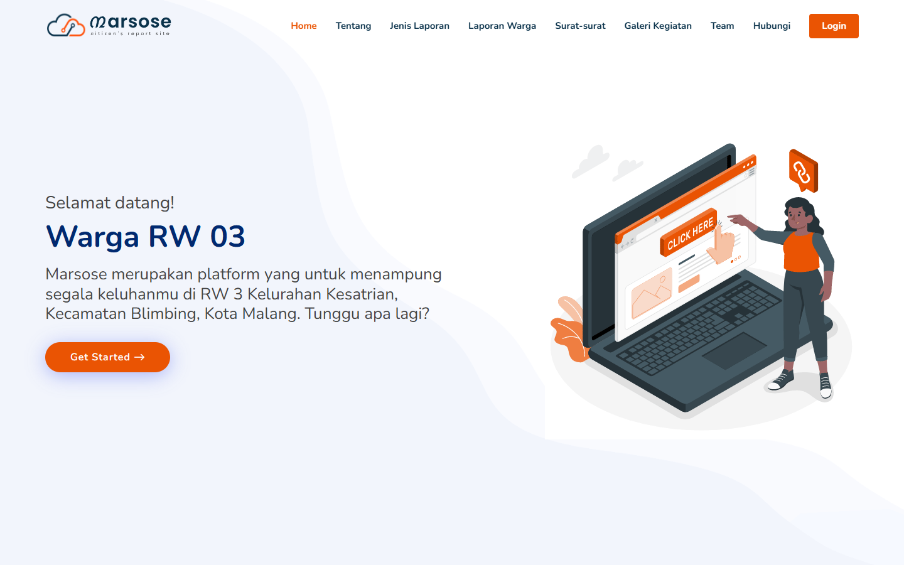
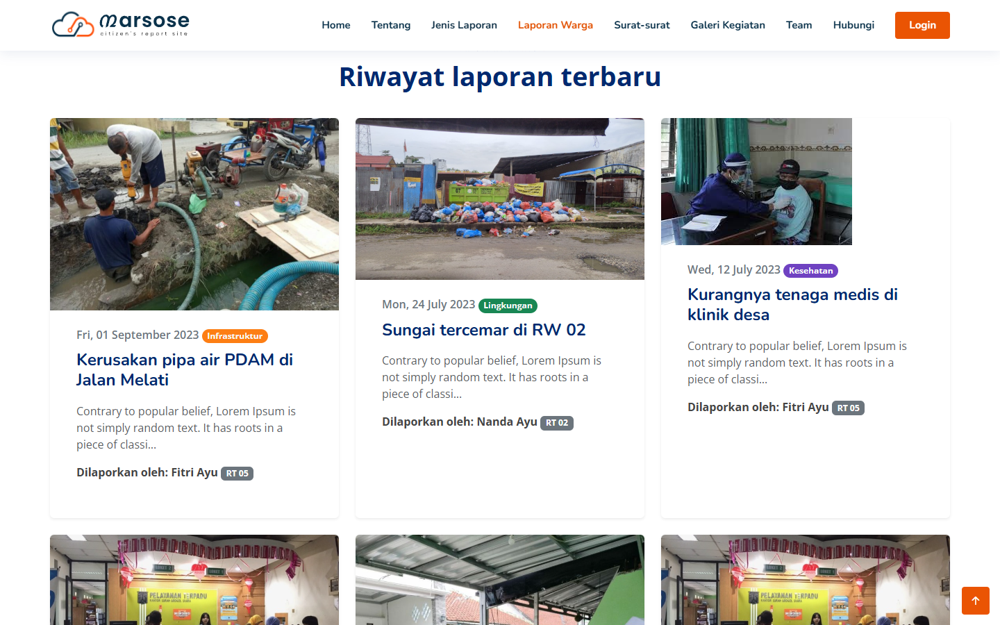
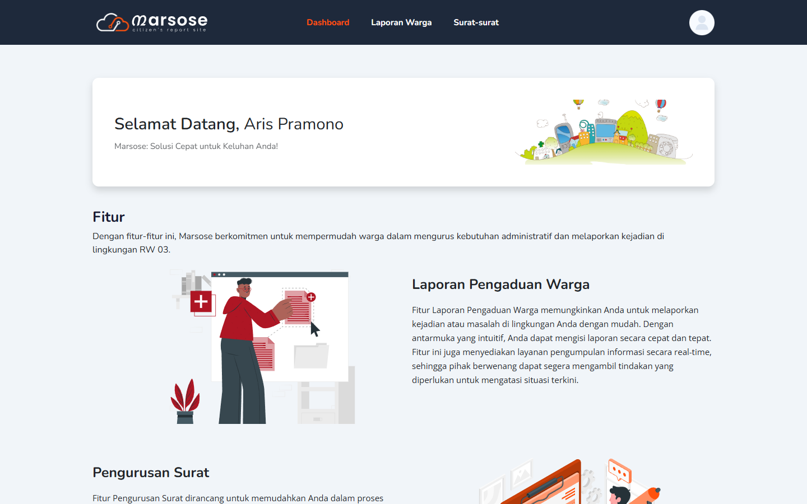
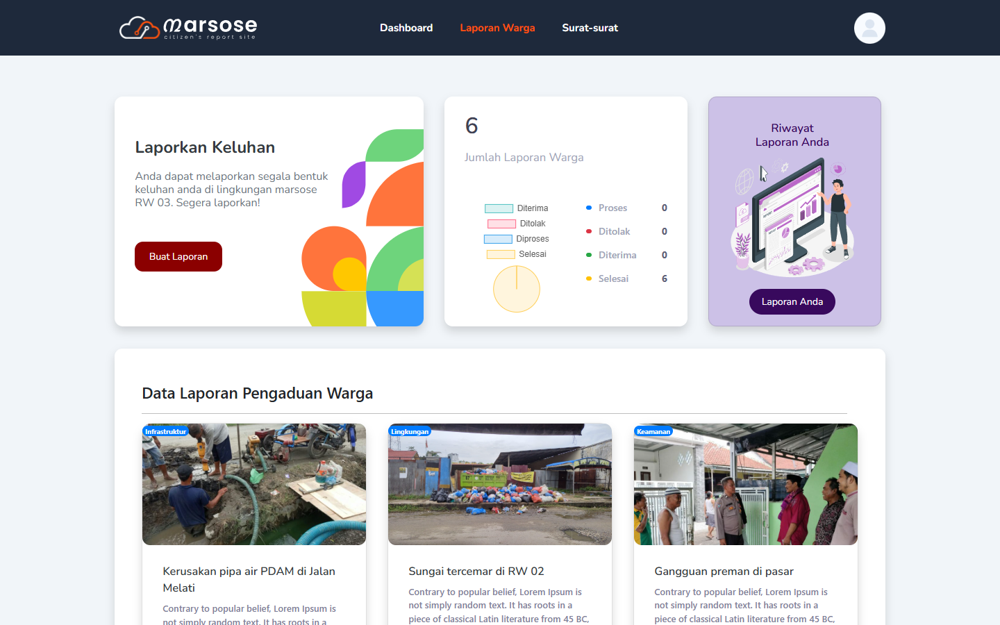
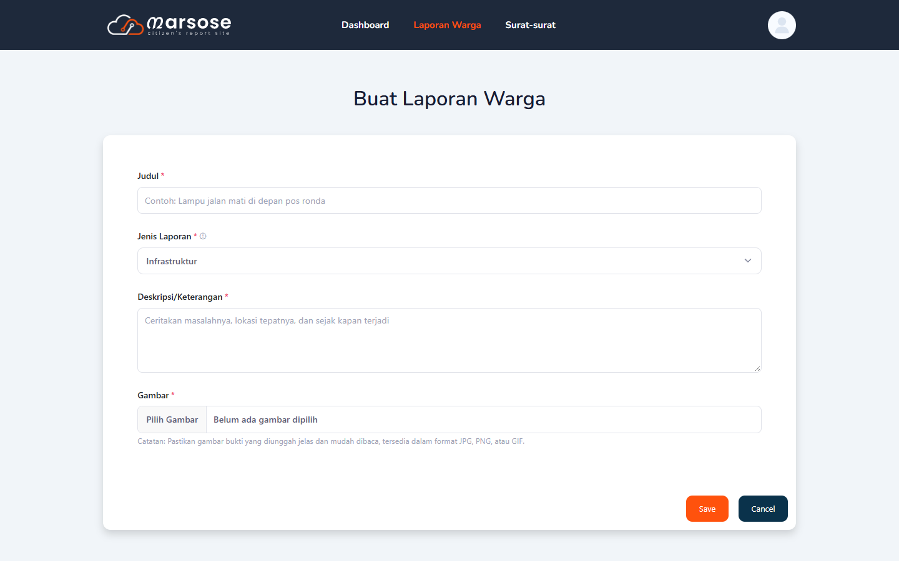
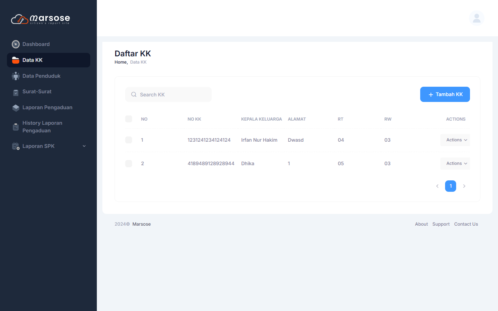
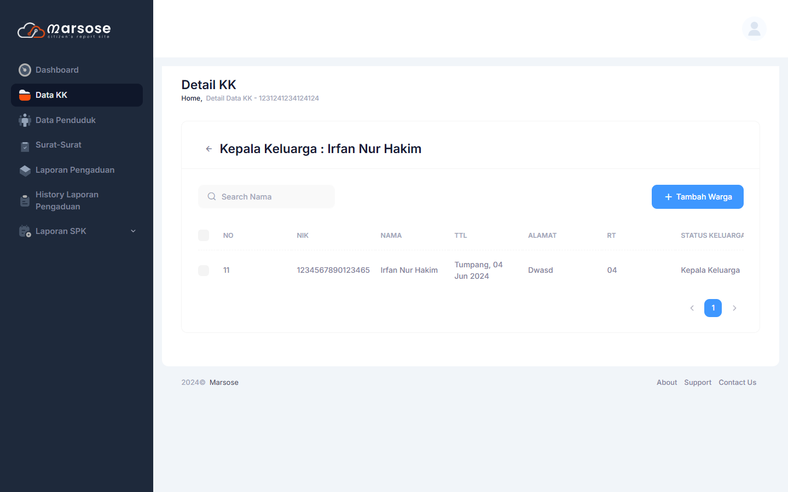
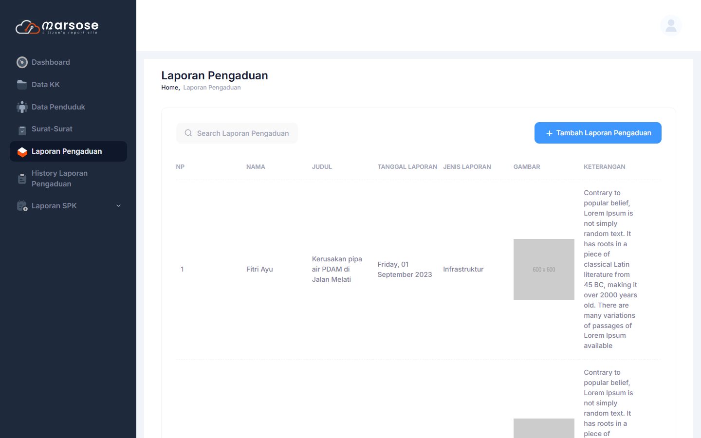
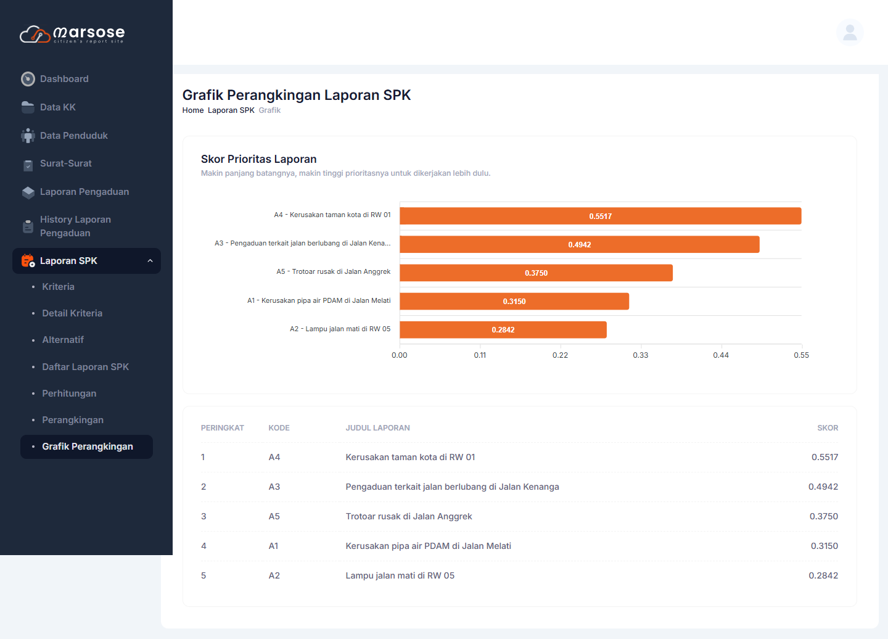
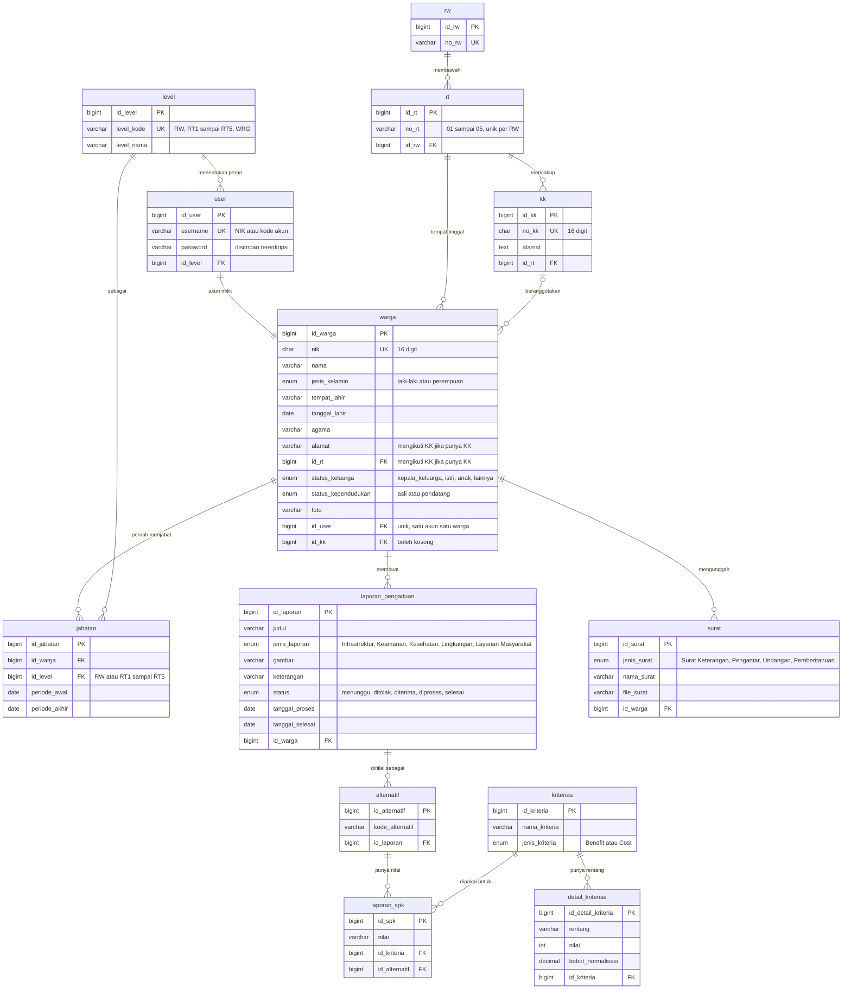

<p align="center">
  
</p>

<p align="center">
  <b>Tempat warga RW 03 menyampaikan keluhan, dan tempat pengurus RT/RW menindaklanjutinya.</b>
</p>

---

## Apa itu Marsose?

Marsose adalah aplikasi web untuk warga **RW 03, Kelurahan Kesatrian, Kecamatan Blimbing, Kota Malang**.

Selama ini, kalau ada jalan rusak, lampu mati, sampah menumpuk, atau masalah keamanan, warga harus menghubungi Pak RT atau Pak RW satu per satu. Laporan itu kemudian dikumpulkan dan dibahas bersama untuk menentukan mana yang harus dikerjakan lebih dulu. Cara ini lambat, mudah terlewat, dan sulit dipantau.

Lewat Marsose:

- **Warga** bisa melapor kapan saja dari HP atau komputer, lengkap dengan foto bukti.
- **Pengurus RT dan RW** bisa melihat semua laporan di satu tempat dan mengelola data kependudukan.
- **Aplikasi membantu menentukan prioritas**: laporan dinilai dan diurutkan secara otomatis, sehingga yang paling mendesak bisa dikerjakan lebih dulu.

---

## Siapa saja penggunanya?

| Pengguna | Apa yang bisa dilakukan |
|---|---|
| 🏠 **Warga** | Membuat laporan pengaduan, melihat riwayat laporannya sendiri, membaca info dan template surat, serta mengubah profil. |
| 👥 **Ketua RT** (RT 1 – RT 5) | Mengelola data Kartu Keluarga dan warga di RT-nya, serta melihat riwayat laporan pengaduan. |
| 🏛️ **Ketua RW** | Mengelola seluruh data: KK, penduduk, surat, dan laporan pengaduan (termasuk mengubah statusnya). Ketua RW juga menjalankan penentuan prioritas laporan. |

---

## Tampilan Aplikasi

### Halaman depan
Halaman yang pertama kali dilihat pengunjung. Isinya penjelasan tentang Marsose, jenis laporan yang bisa dikirim, info surat, galeri kegiatan, dan kontak.



Pengunjung juga bisa melihat laporan terbaru dari warga, lengkap dengan foto, jenis laporan, dan RT pelapornya.



### Halaman masuk
Semua pengguna (warga, RT, dan RW) masuk dari halaman yang sama. Aplikasi otomatis membuka halaman yang sesuai dengan peran masing-masing.


### Untuk warga

**Beranda warga**: sapaan dan penjelasan singkat tentang fitur yang bisa dipakai.



**Laporan warga**: ringkasan jumlah laporan per status dan daftar laporan dari seluruh warga. Klik fotonya untuk melihat versi besar tanpa meninggalkan halaman.



**Membuat laporan**: cukup isi judul, pilih jenis laporan (Infrastruktur, Keamanan, Kesehatan, Lingkungan, atau Layanan Masyarakat), tulis keterangan, lalu unggah foto bukti.



**Informasi surat**: penjelasan tiap jenis surat (keterangan, pengantar, undangan, pemberitahuan), alur pengurusannya, dan template beserta persyaratannya. Template yang sudah diunggah pengurus RW bisa langsung diunduh.


### Untuk pengurus RW

**Dashboard**: ringkasan jumlah laporan, warga, dan RT, serta grafik laporan per jenis, laporan per status, dan jumlah penduduk per RT.


**Data Kartu Keluarga**: daftar KK beserta kepala keluarga, alamat, RT, dan RW-nya.



**Detail KK**: anggota keluarga dalam satu KK. Nama kepala keluarga diambil dari anggota yang berstatus kepala keluarga, jadi selalu sama dengan data penduduknya.



**Data penduduk**: daftar seluruh warga beserta NIK, alamat, RT, dan statusnya. Data bisa dicari, ditambah, diubah, dan dihapus.


**Laporan pengaduan**: semua laporan yang masuk dari warga, lengkap dengan foto dan keterangannya.



**Kriteria penentuan prioritas**: dasar penilaian untuk mengurutkan laporan (lihat penjelasan di bawah).


**Grafik perangkingan**: hasil penentuan prioritas dalam bentuk grafik batang, dari laporan yang paling perlu didahulukan. Skornya sama dengan yang tampil di halaman Perangkingan.



---

## Bagaimana aplikasi menentukan laporan mana yang didahulukan?

Tidak semua laporan bisa dikerjakan sekaligus. Karena itu Marsose punya fitur **Sistem Pendukung Keputusan (SPK)** yang membantu RW mengurutkan laporan dari yang paling penting.

Setiap laporan dinilai berdasarkan 5 hal:

| Kriteria | Artinya | Pengaruhnya |
|---|---|---|
| **Dampak** | Seberapa besar akibatnya bagi warga | Makin besar, makin diprioritaskan |
| **Biaya** | Perkiraan biaya penanganan | Makin murah, makin diprioritaskan |
| **Jenis laporan** | Kategori masalahnya | Kategori tertentu lebih diprioritaskan |
| **SDM** | Jumlah orang yang dibutuhkan | Makin sedikit, makin diprioritaskan |
| **Durasi pekerjaan** | Lama waktu pengerjaan | Makin cepat selesai, makin diprioritaskan |

Secara sederhana, cara kerjanya:
1. Setiap kriteria diberi **bobot** sesuai urutan kepentingannya. Kriteria yang lebih penting mendapat bobot lebih besar (metode *Rank Order Centroid / ROC*).
2. Nilai setiap laporan diubah ke skala yang sama (0 sampai 1) supaya bisa dibandingkan dengan adil.
3. Nilai tersebut dikalikan bobotnya lalu dijumlahkan menjadi **skor akhir**.
4. Laporan diurutkan dari skor tertinggi. Yang paling atas adalah yang sebaiknya dikerjakan lebih dulu.

Hasilnya hanya rekomendasi. Keputusan akhir tetap ada di tangan pengurus RW.

---

## Struktur Database (ERD)

Diagram di bawah menunjukkan tabel-tabel yang dipakai Marsose dan hubungan antar tabelnya.



**Cara membaca diagram:**

| Tabel | Isinya |
|---|---|
| `level` | Daftar peran: RW, RT 1 sampai RT 5, dan Warga |
| `user` | Akun untuk login. Setiap akun punya satu peran |
| `rw`, `rt` | Wilayah. Satu RW membawahi beberapa RT. Nomor RT tidak boleh kembar dalam satu RW, tapi RT 01 boleh ada di RW lain |
| `kk` | Kartu Keluarga. Setiap KK terdaftar di satu RT. Nama kepala keluarga diambil dari anggota warga yang berstatus kepala keluarga |
| `warga` | Data penduduk. Setiap warga punya tepat satu akun, tinggal di satu RT, dan bisa tergabung dalam satu KK. Kalau warga punya KK, RT dan alamatnya otomatis mengikuti KK |
| `jabatan` | Riwayat jabatan Ketua RW dan Ketua RT beserta periodenya. Riwayat lama tetap tersimpan saat jabatan berganti |
| `laporan_pengaduan` | Laporan yang dikirim warga, lengkap dengan foto dan statusnya. Jenis laporan hanya bisa dipilih dari daftar baku |
| `surat` | File template surat yang diunggah pengurus. Jenis surat hanya bisa dipilih dari daftar baku |
| `kriterias`, `detail_kriterias` | Kriteria penilaian prioritas beserta rentang nilainya |
| `alternatif`, `laporan_spk` | Laporan yang sedang dinilai dan nilainya untuk setiap kriteria |

Arti garis penghubung: `||` berarti **tepat satu**, `o{` berarti **boleh nol atau banyak**, dan `|o` berarti **boleh kosong atau satu**. Contohnya, satu RT bisa punya banyak KK, tapi setiap KK hanya terdaftar di satu RT.

**Aturan yang dijaga langsung oleh database:**
- **Data tidak bisa dobel:** username, NIK, nomor KK, dan akun milik warga masing-masing unik.
- **Isian baku:** jenis laporan dan jenis surat hanya menerima pilihan yang tersedia, sehingga "Infrastruktur" tidak tercatat dengan ejaan berbeda-beda.
- **Perlindungan saat menghapus:** data yang masih dipakai data lain tidak bisa dihapus. Contohnya, warga yang pernah membuat laporan atau mengunggah surat tidak bisa dihapus, begitu juga RT yang masih punya KK atau warga, RW yang masih punya RT, dan level yang masih dipakai akun. Penghapusan seperti ini ditolak seluruhnya, tidak ada data yang terhapus sebagian. Pengecualiannya: menghapus KK tidak menghapus warganya (warga hanya dilepas dari KK), dan menghapus laporan ikut menghapus data penilaian SPK-nya.

---

## Cara Menjalankan di Komputer Sendiri

Bagian ini untuk yang ingin mencoba atau mengembangkan aplikasinya.

### Yang perlu disiapkan
- **[Laragon](https://laragon.org/)** (sudah berisi PHP, MySQL, dan web server), atau XAMPP
- **PHP 8.1 – 8.4**
- **MySQL** 5.7 / 8.0
- **[Composer](https://getcomposer.org/)**
- **Git**

### Langkah-langkah

**1. Unduh project**
```bash
git clone https://github.com/Dhiyun/MarsoseAsolole.git Marsose
cd Marsose
```
Kalau pakai Laragon, simpan foldernya di dalam `laragon/www/`.

**2. Pasang library yang dibutuhkan**
```bash
composer install
```

**3. Siapkan file pengaturan**
```bash
cp .env.example .env
php artisan key:generate
```
Buka file `.env`, lalu sesuaikan bagian database seperti tabel berikut:

| Pengaturan | Nilai | Keterangan |
|---|---|---|
| `DB_CONNECTION` | `mysql` | Jenis database yang dipakai |
| `DB_HOST` | `127.0.0.1` | Alamat server MySQL (komputer sendiri) |
| `DB_PORT` | `3306` | Port bawaan MySQL. Ubah kalau MySQL-mu memakai port lain |
| `DB_DATABASE` | `marsose` | Nama database aplikasi (dibuat di langkah 4) |
| `DB_USERNAME` | `root` | User MySQL. Bawaan Laragon/XAMPP adalah `root` |
| `DB_PASSWORD` | *(kosong)* | Password MySQL. Bawaan Laragon/XAMPP kosong |

Hasilnya di file `.env` akan terlihat seperti ini:
```env
DB_CONNECTION=mysql
DB_HOST=127.0.0.1
DB_PORT=3306
DB_DATABASE=marsose
DB_USERNAME=root
DB_PASSWORD=
```

Untuk test otomatis, aplikasi memakai database terpisah bernama `marsose_testing` dengan pengaturan lain yang sama. Nama ini sudah diatur di `phpunit.xml`, jadi tidak perlu ditulis di `.env`.

**4. Buat database**

Nyalakan MySQL (di Laragon klik **Start All**), lalu buat database baru bernama `marsose`, misalnya lewat HeidiSQL atau phpMyAdmin.

**5. Isi database dengan tabel dan data awal**
```bash
php artisan migrate --seed
```

**6. Jalankan aplikasi**
```bash
php artisan serve
```
Buka **http://127.0.0.1:8000** di browser.

Ingin memakai port lain? Jalankan `php artisan serve --port=8080`, atau tambahkan `SERVER_PORT=8080` di file `.env`.

Kalau pakai Laragon, aplikasi juga bisa dibuka lewat **http://marsose.test** tanpa menjalankan `php artisan serve`.

### Sudah pernah memasang, lalu menarik perubahan terbaru?

Setelah `git pull`, jalankan dua perintah ini supaya library dan struktur database ikut diperbarui. Data yang sudah ada tetap aman.

```bash
composer install
php artisan migrate
```

### Akun untuk mencoba

Setelah langkah 5, akun-akun berikut otomatis tersedia:

| Peran | Username | Password |
|---|---|---|
| Ketua RW | `123` | `superadmin` |
| Ketua RT 1 | `234` | `admin1` |
| Ketua RT 2 | `345` | `admin2` |
| Ketua RT 3 | `456` | `admin3` |
| Ketua RT 4 | `567` | `admin4` |
| Ketua RT 5 | `678` | `admin5` |
| Warga | `789` | `warga` |

Akun warga lain memakai NIK sebagai username sekaligus password awal.

Password bisa diganti kapan saja lewat menu **My Profile**, di bagian **Ganti Password**. Isi password lama, lalu password baru dua kali.

> ⚠️ Akun di atas hanya untuk percobaan. Ganti semua password sebelum aplikasi dipakai sungguhan, terutama akun warga yang password-nya masih sama dengan NIK, karena NIK mudah diketahui orang lain.

### Mengangkat Ketua RW atau Ketua RT

Jabatan diberikan kepada warga yang sudah terdaftar:

1. Login sebagai Ketua RW, lalu buka menu **Data Penduduk**.
2. Pada warga yang akan diangkat, klik **Actions → Detail**.
3. Di bagian **Edit User**, ubah **Level** menjadi RW atau RT yang sesuai, lalu isi **Periode Jabatan** (tanggal awal dan akhir).
4. Simpan. Warga tersebut sekarang masuk dengan NIK dan password-nya sendiri, dan langsung diarahkan ke halaman pengurus.

Untuk mencabut jabatan, ubah Level kembali menjadi **Warga**. Riwayat jabatannya tetap tersimpan. Ketua RT juga bisa mengangkat penggantinya sebagai Ketua RT di RT-nya sendiri, tapi tidak bisa memberi jabatan RW.

### Kalau ada kendala

| Masalah | Solusi |
|---|---|
| Muncul banyak tulisan `Deprecated: ...` | Library belum terpasang sesuai `composer.lock`. Pastikan memakai PHP 8.1 – 8.4, lalu jalankan `composer install` lagi. |
| `Too Many Attempts` saat login | Login salah lebih dari 10 kali dalam 1 menit. Tunggu sebentar, lalu coba lagi. |
| `No connection could be made because the target machine actively refused it` | MySQL belum menyala. Di Laragon, klik **Start All**. |
| `Unknown database 'marsose'` | Database belum dibuat. Ulangi langkah 4. |
| Gambar atau foto profil tidak muncul | Gambar disimpan di folder `public/gambar` dan `public/uploads`. Pastikan kedua folder itu ada dan bisa ditulisi. |
| `Akun Anda belum terhubung dengan data warga` saat login | Akun tersebut belum punya data penduduk. Login sebagai RW, lalu tambahkan warga dengan NIK yang sama dengan username akun itu. |
| `Nomor RT tidak terdaftar` saat menyimpan data | Nomor RT yang diisi belum ada di database. Gunakan RT 01 sampai 05. |
| Lupa password | Reset lewat `php artisan tinker`:<br>`App\Models\Users::where('username', '123')->update(['password' => bcrypt('passwordbaru')]);` |

---

## Dibuat Dengan

- [Laravel 10](https://laravel.com/) sebagai kerangka aplikasi (PHP)
- MySQL sebagai database
- Bootstrap dan template Metronic untuk tampilan

---

## Tim Pengembang

| Nama | Peran |
|---|---|
| Dany Fatihul Ihsan | Project Manager |
| Dhika Wahyu Nugroho | Programmer |
| Febrianti Mayori | Dokumentasi |
| Larasati Puspita Candra Dewi | Tester |
| Muhammad Irfan Nur Hakim | Desainer |
