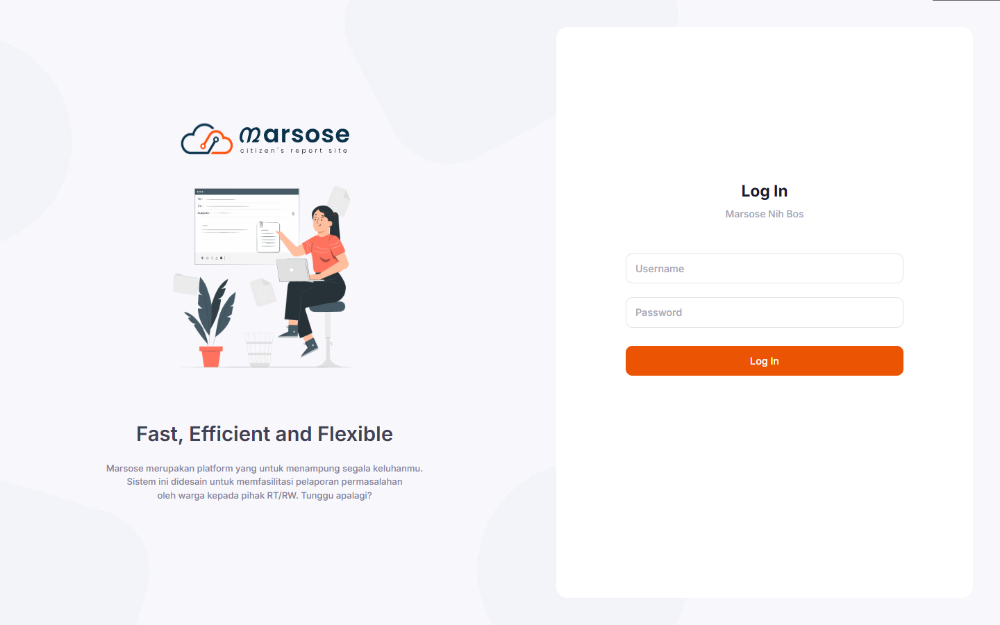
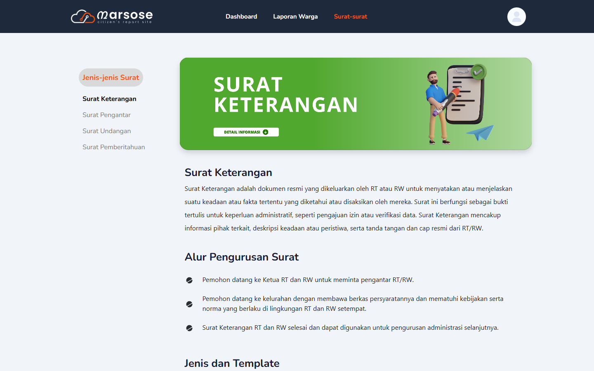
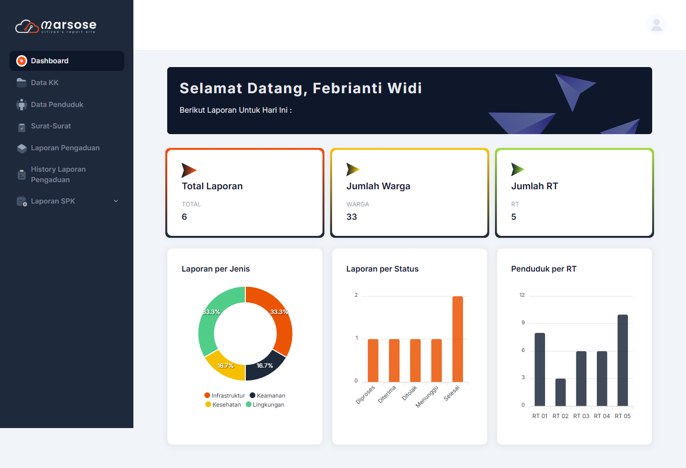
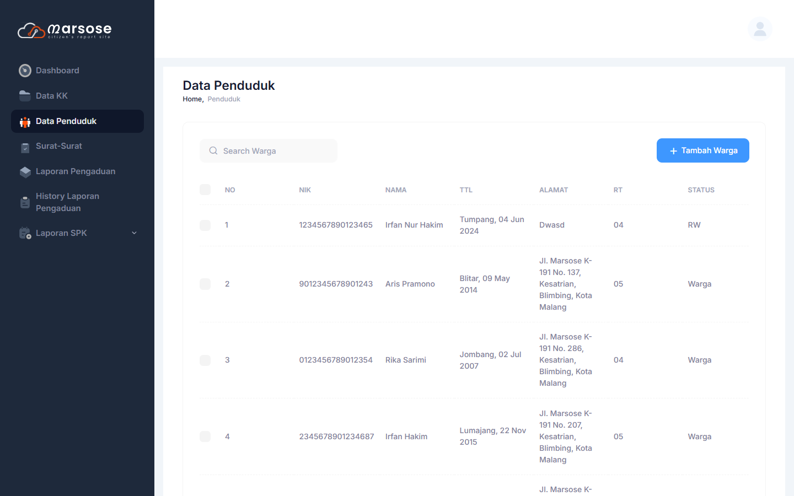
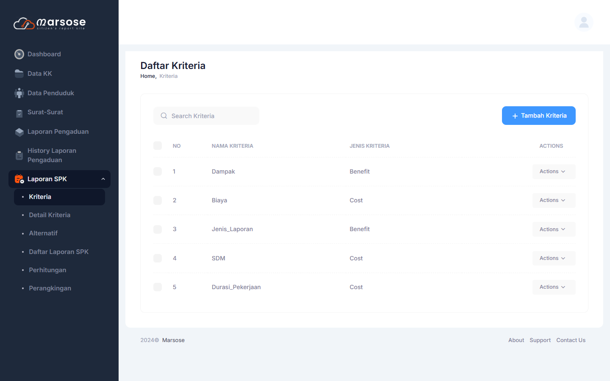

<p align="center">
  
</p>

<p align="center">
  <b>Tempat warga RW 03 menyampaikan keluhan, dan tempat pengurus RT/RW menindaklanjutinya.</b>
</p>

---

## Apa itu Marsose?

Marsose adalah aplikasi web untuk warga **RW 03, Kelurahan Kesatrian, Kecamatan Blimbing, Kota Malang**.

Selama ini, kalau ada jalan rusak, lampu mati, sampah menumpuk, atau masalah keamanan, warga harus menghubungi Pak RT atau Pak RW satu per satu. Laporan itu kemudian dikumpulkan dan dibahas bersama untuk menentukan mana yang harus dikerjakan lebih dulu. Cara ini lambat, mudah terlewat, dan sulit dipantau.

Lewat Marsose:

- **Warga** bisa melapor kapan saja dari HP atau komputer, lengkap dengan foto bukti.
- **Pengurus RT dan RW** bisa melihat semua laporan di satu tempat dan mengelola data kependudukan.
- **Aplikasi membantu menentukan prioritas**: laporan dinilai dan diurutkan secara otomatis, sehingga yang paling mendesak bisa dikerjakan lebih dulu.

---

## Siapa saja penggunanya?

| Pengguna | Apa yang bisa dilakukan |
|---|---|
| 🏠 **Warga** | Membuat laporan pengaduan, melihat riwayat laporannya sendiri, membaca info dan template surat, serta mengubah profil. |
| 👥 **Ketua RT** (RT 1 – RT 5) | Mengelola data Kartu Keluarga dan warga di RT-nya, serta melihat riwayat laporan pengaduan. |
| 🏛️ **Ketua RW** | Mengelola seluruh data: KK, penduduk, surat, dan laporan pengaduan (termasuk mengubah statusnya). Ketua RW juga menjalankan penentuan prioritas laporan. |

---

## Tampilan Aplikasi

### Halaman depan
Halaman yang pertama kali dilihat pengunjung. Isinya penjelasan tentang Marsose, jenis laporan yang bisa dikirim, info surat, galeri kegiatan, dan kontak.


### Halaman masuk
Semua pengguna (warga, RT, dan RW) masuk dari halaman yang sama. Aplikasi otomatis membuka halaman yang sesuai dengan peran masing-masing.



### Untuk warga

**Beranda warga**: sapaan dan penjelasan singkat tentang fitur yang bisa dipakai.


**Membuat laporan**: cukup isi judul, pilih jenis laporan (Infrastruktur, Keamanan, Kesehatan, Lingkungan), tulis keterangan, lalu unggah foto bukti.


**Informasi surat**: penjelasan tiap jenis surat (keterangan, pengantar, undangan, pemberitahuan), alur pengurusannya, dan template yang bisa diunduh.



### Untuk pengurus RW

**Dashboard**: ringkasan jumlah laporan, warga, dan RT, serta grafik laporan per jenis, laporan per status, dan jumlah penduduk per RT.



**Data penduduk**: daftar seluruh warga beserta NIK, alamat, RT, dan statusnya. Data bisa dicari, ditambah, diubah, dan dihapus.



**Laporan pengaduan**: semua laporan yang masuk dari warga, lengkap dengan foto dan keterangannya.


**Kriteria penentuan prioritas**: dasar penilaian untuk mengurutkan laporan (lihat penjelasan di bawah).



---

## Bagaimana aplikasi menentukan laporan mana yang didahulukan?

Tidak semua laporan bisa dikerjakan sekaligus. Karena itu Marsose punya fitur **Sistem Pendukung Keputusan (SPK)** yang membantu RW mengurutkan laporan dari yang paling penting.

Setiap laporan dinilai berdasarkan 5 hal:

| Kriteria | Artinya | Pengaruhnya |
|---|---|---|
| **Dampak** | Seberapa besar akibatnya bagi warga | Makin besar, makin diprioritaskan |
| **Biaya** | Perkiraan biaya penanganan | Makin murah, makin diprioritaskan |
| **Jenis laporan** | Kategori masalahnya | Kategori tertentu lebih diprioritaskan |
| **SDM** | Jumlah orang yang dibutuhkan | Makin sedikit, makin diprioritaskan |
| **Durasi pekerjaan** | Lama waktu pengerjaan | Makin cepat selesai, makin diprioritaskan |

Secara sederhana, cara kerjanya:
1. Setiap kriteria diberi **bobot** sesuai urutan kepentingannya. Kriteria yang lebih penting mendapat bobot lebih besar (metode *Rank Order Centroid / ROC*).
2. Nilai setiap laporan diubah ke skala yang sama (0 sampai 1) supaya bisa dibandingkan dengan adil.
3. Nilai tersebut dikalikan bobotnya lalu dijumlahkan menjadi **skor akhir**.
4. Laporan diurutkan dari skor tertinggi. Yang paling atas adalah yang sebaiknya dikerjakan lebih dulu.

Hasilnya hanya rekomendasi. Keputusan akhir tetap ada di tangan pengurus RW.

---

## Cara Menjalankan di Komputer Sendiri

Bagian ini untuk yang ingin mencoba atau mengembangkan aplikasinya.

### Yang perlu disiapkan
- **[Laragon](https://laragon.org/)** (sudah berisi PHP, MySQL, dan web server), atau XAMPP
- **PHP 8.1 – 8.4**
- **MySQL** 5.7 / 8.0
- **[Composer](https://getcomposer.org/)**
- **Git**

### Langkah-langkah

**1. Unduh project**
```bash
git clone https://github.com/Dhiyun/MarsoseAsolole.git Marsose
cd Marsose
```
Kalau pakai Laragon, simpan foldernya di dalam `laragon/www/`.

**2. Pasang library yang dibutuhkan**
```bash
composer install
```

**3. Siapkan file pengaturan**
```bash
cp .env.example .env
php artisan key:generate
```
Buka file `.env`, lalu sesuaikan bagian database:
```env
DB_DATABASE=marsose
DB_USERNAME=root
DB_PASSWORD=
```

**4. Buat database**

Nyalakan MySQL (di Laragon klik **Start All**), lalu buat database baru bernama `marsose`, misalnya lewat HeidiSQL atau phpMyAdmin.

**5. Isi database dengan tabel dan data awal**
```bash
php artisan migrate --seed
php artisan storage:link
```

**6. Jalankan aplikasi**
```bash
php artisan serve
```
Buka **http://127.0.0.1:8000** di browser.

Ingin memakai port lain? Jalankan `php artisan serve --port=8080`, atau tambahkan `SERVER_PORT=8080` di file `.env`.

Kalau pakai Laragon, aplikasi juga bisa dibuka lewat **http://marsose.test** tanpa menjalankan `php artisan serve`.

### Akun untuk mencoba

Setelah langkah 5, akun-akun berikut otomatis tersedia:

| Peran | Username | Password |
|---|---|---|
| Ketua RW | `123` | `superadmin` |
| Ketua RT 1 | `234` | `admin1` |
| Ketua RT 2 | `345` | `admin2` |
| Ketua RT 3 | `456` | `admin3` |
| Ketua RT 4 | `567` | `admin4` |
| Ketua RT 5 | `678` | `admin5` |
| Warga | `789` | `warga` |

Akun warga lain memakai NIK sebagai username sekaligus password awal. Saat pertama kali masuk, mereka akan diminta membuat password baru, karena NIK mudah diketahui orang lain.

> ⚠️ Akun di atas hanya untuk percobaan. Ganti semua password sebelum aplikasi dipakai sungguhan.

### Kalau ada kendala

| Masalah | Solusi |
|---|---|
| Muncul banyak tulisan `Deprecated: ...` | Library belum terpasang sesuai `composer.lock`. Pastikan memakai PHP 8.1 – 8.4, lalu jalankan `composer install` lagi. |
| `Too Many Attempts` saat login | Login salah lebih dari 10 kali dalam 1 menit. Tunggu sebentar, lalu coba lagi. |
| `No connection could be made because the target machine actively refused it` | MySQL belum menyala. Di Laragon, klik **Start All**. |
| `Unknown database 'marsose'` | Database belum dibuat. Ulangi langkah 4. |
| Gambar atau foto profil tidak muncul | Jalankan `php artisan storage:link`. |
| Lupa password | Reset lewat `php artisan tinker`:<br>`App\Models\Users::where('username', '123')->update(['password' => bcrypt('passwordbaru')]);` |

### Menjalankan test otomatis

Test memakai database terpisah bernama `marsose_testing`, supaya data aslimu tidak tersentuh. Buat database itu sekali saja, lalu jalankan:

```bash
php artisan test
```

Test ini memeriksa bahwa:
- setiap peran diarahkan ke halaman yang benar setelah login,
- akun dengan password = NIK wajib membuat password baru,
- Ketua RT tidak bisa melihat, mengubah, atau menghapus data warga RT lain, dan tidak bisa memberi jabatan RW,
- file gambar yang diunggah warga aman (SVG ditolak, ekstensi file mengikuti isi file).

---

## Dibuat Dengan

- [Laravel 10](https://laravel.com/) sebagai kerangka aplikasi (PHP)
- MySQL sebagai database
- Bootstrap dan template Metronic untuk tampilan

---

## Tim Pengembang

| Nama | Peran |
|---|---|
| Dany Fatihul Ihsan | Project Manager |
| Dhika Wahyu Nugroho | Programmer |
| Febrianti Mayori | Dokumentasi |
| Larasati Puspita Candra Dewi | Tester |
| Muhammad Irfan Nur Hakim | Desainer |
